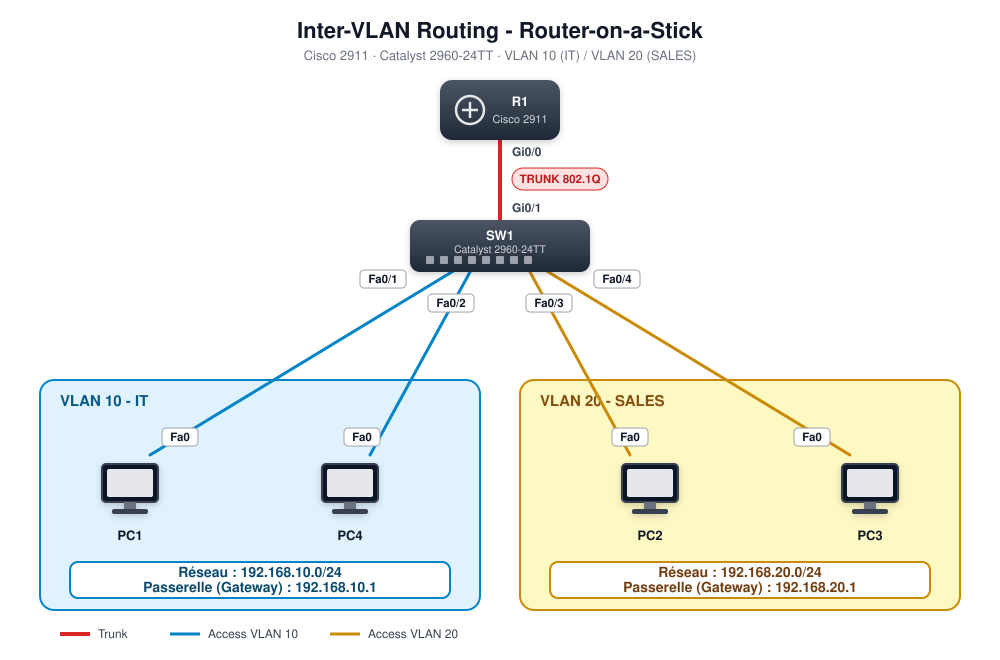

# Project 02 – HSRP Gateway Redundancy

## Project Overview
Implementation of Gateway Redundancy using HSRP in Cisco Packet Tracer.

## Objectives
- Configure HSRP between two Cisco routers.
- Configure Active and Standby routers.
- Configure a Virtual IP Address.
- Set router priority and preemption.
- Test Gateway Failover and Recovery.

## Network Topology

## IP Addressing

| Device | IP Address |
|---|---|
| R1 | 192.168.10.2/24 |
| R2 | 192.168.10.3/24 |
| Virtual Gateway | 192.168.10.1 |

## Technologies
- Cisco Packet Tracer
- HSRP
- Gateway Redundancy
- High Availability
- IPv4

## Verification
- Verified Active and Standby router states.
- Tested gateway connectivity.
- Simulated R1 failure.
- Verified R2 takeover.
- Tested R1 recovery using preemption.

## Project Files
- Packet Tracer simulation: `HSRP-Gateway-Redundancy.pkt`
- Screenshots: `Screenshots/`

## Disclaimer
This is a personal educational lab developed using Cisco Packet Tracer. It is not a production deployment.
